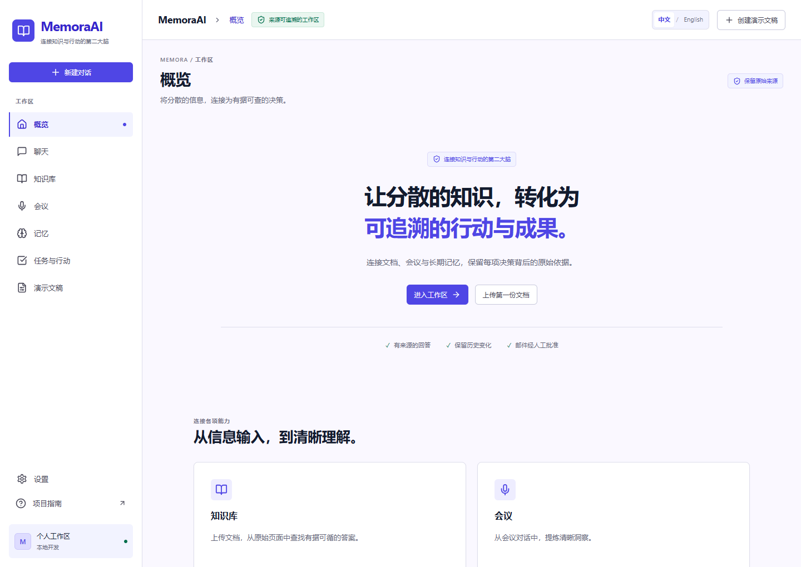
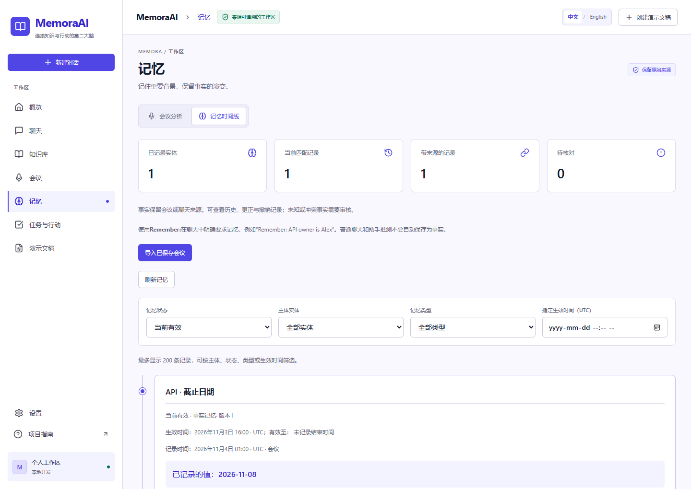
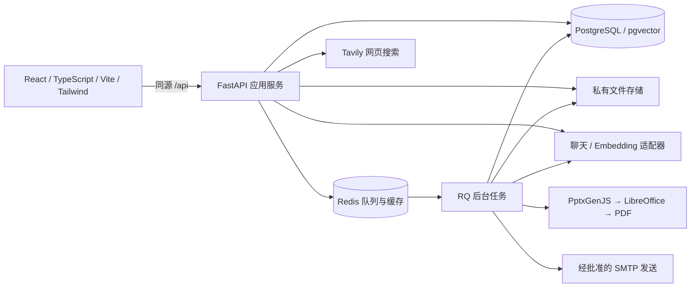

# MemoraAI

**把文档、会议与对话连接起来，让回答有依据，让行动可追溯。**

MemoraAI 是一个可在本地运行的 AI 知识与行动工作区，适合个人项目管理、会议跟进和资料整理。它将 PDF 问答、会议结构化分析、跨会话记忆、任务与邮件审批、网页检索和演示文稿生成放在同一套界面中。

例如：导入项目简报和两次会议后，可以询问“API 由谁负责？截止日期如何变化？”，查看原始页面或会议行号，再审阅任务、编辑邮件草稿，或将所选资料组织成可下载的演示文稿。

当前定位为单用户本地演示与研究项目，使用固定演示身份，没有面向公网的登录和租户管理。请保持默认的本机端口绑定。

## 功能与界面

| 功能       | 使用方式                                                                      |
| ---------- | ----------------------------------------------------------------------------- |
| 流式聊天   | 分会话保存历史，可停止生成、保留部分回答并明确重试                            |
| PDF 知识库 | 校验上传文件，后台解析、分块和向量化，结合向量与全文检索返回带页码的回答      |
| 会议分析   | 导入 UTF-8 TXT，提取人物、决策、风险和任务建议，保留日期、时区与原文行号      |
| 长期记忆   | 管理实体与别名，查看事实来源和时间变化，支持更正、撤销及跨会话查询            |
| 任务与邮件 | 审阅和编辑任务、邮件草稿；只有对已保存版本明确批准后才会排队发送              |
| 网页检索   | 按需调用 Tavily，展示来源链接和检索时间；命中缓存时保留原时间                 |
| 演示文稿   | 从所选内部资料和可选网页资料生成结构化大纲，再生成可编辑 PPTX、PDF 预览与下载 |
| 中英文界面 | 默认简体中文，顶部切换 English 并保存偏好；已有资料不会随切换被自动改写       |

截图使用合成演示资料展示当前界面，实际内容以导入的资料为准。





## 架构与技术栈



后端采用模块化 FastAPI 单体，任务执行与网页请求分离。模型输出不能直接执行脚本或发送邮件。

| 路径                                       | 职责                                                         |
| ------------------------------------------ | ------------------------------------------------------------ |
| `frontend/src/features/`                   | 聊天、资料、会议、记忆、任务和演示文稿界面；PDF.js 渲染预览  |
| `backend/app/api/`、`backend/app/schemas/` | `/api` 路由、Pydantic 请求响应契约和错误结构                 |
| `backend/app/services/`                    | 检索、证据检查、记忆历史、幂等、审批、所有权及供应商适配     |
| `backend/app/agents/`                      | LangGraph 对话流程与 PostgreSQL 持久化检查点                 |
| `backend/app/workers/`                     | RQ 文档处理、会议分析、邮件及演示文稿后台任务                |
| `backend/renderer/`                        | 固定 PptxGenJS 渲染程序，将大纲数据转成原生可编辑文字和形状  |
| `backend/alembic/`                         | SQLAlchemy 数据结构对应的 Alembic 迁移                       |
| `docs/api/openapi.json`                    | API 契约快照；用于生成前端接口类型                           |
| `demo-data/`                               | 可自行导入的合成 PDF、会议原文与参考数据，不会自动写入数据库 |

PDF 使用 PyMuPDF 提取文字，检索结合 pgvector 和 PostgreSQL 全文搜索。记忆区分事件发生时间与记录时间，更新事实时保留旧版本和来源。相同上传、请求键和重复批准受到幂等保护；来源内容始终作为数据处理。

## 环境要求

推荐使用 Docker Compose 运行完整应用：

- Git、Docker Engine 或 Docker Desktop，启用 Linux 容器和 Docker Compose v2+。
- 首次构建需要访问镜像仓库、Python/npm 包仓库及系统软件源。
- 默认端口：网页 `5173`、API `8000`、PostgreSQL `5432`、Redis `6379`；本地邮箱另用 `8025`、`1025`。端口可在配置中调整。
- 只有本地开发和代码检查才需要主机安装 Python 3.13+、Node.js 22.12+ 和 npm。完整容器运行不要求主机安装 LibreOffice。

依赖版本分别锁定在 `backend/requirements.lock`、`backend/requirements-dev.lock`、`frontend/package-lock.json` 和 `backend/renderer/package-lock.json` 中。

## 快速启动

### 1. 获取项目与配置

```sh
git clone https://github.com/raymondstfx/Memora-AI.git
cd Memora-AI
```

首次使用时复制配置模板。Windows PowerShell：

```powershell
Copy-Item .env.example .env
```

macOS / Linux：

```sh
cp .env.example .env
```

**已有 `.env` 时不要重新复制覆盖。** 根目录 `.env` 同时供 Compose 和本地后端读取；它被 Git 忽略。密钥只填写在后端配置中，不使用 `VITE_*` 保存密钥。

### 2. 填写需要的服务配置

可以不填 Key 启动应用、查看界面和已有历史；需要生成回答、分析会议、建立向量索引或搜索时，必须配置对应服务。缺少配置会明确报错，不会返回模拟成功。

| 配置                                                         | 用途与注意事项                                                                     |
| ------------------------------------------------------------ | ---------------------------------------------------------------------------------- |
| `LLM_API_KEY`、`LLM_MODEL`、`LLM_BASE_URL`                   | 聊天、会议分析和大纲生成；Base URL 为 API 根路径，不附加 `/chat/completions`       |
| `LLM_TOKEN_PARAMETER`、`LLM_REASONING_EFFORT`                | 必须与所选模型支持的参数一致；不能把某一模型的参数原样套用给其他模型               |
| `EMBEDDING_API_KEY`、`EMBEDDING_MODEL`、`EMBEDDING_BASE_URL` | PDF 建索引和查询向量；可以与聊天模型使用不同服务                                   |
| `EMBEDDING_DIMENSIONS`、`EMBEDDING_SEND_DIMENSIONS`          | 模型与返回维度配套；服务不支持 `dimensions` 请求字段时关闭发送，但仍须填写实际维度 |
| `EMBEDDING_NORMALIZE`                                        | 向量归一化也属于索引配置；变更后不能直接混用旧向量                                 |
| `SEARCH_API_KEY`                                             | 可选 Tavily 搜索；不使用网页资料时可以留空                                         |
| `DATABASE_URL`、`REDIS_URL`、`STORAGE_ROOT`                  | 主机开发连接与文件路径；Compose 会覆盖容器内的连接地址并挂载私有文件卷             |
| `SMTP_MODE`、`SMTP_EXTERNAL_SEND_ENABLED`                    | 邮件运行模式，默认保留本地捕获及关闭外发，详见邮件说明                             |

模板中的聊天示例为 Gemini 官方 OpenAI-compatible 接口：

```dotenv
LLM_PROVIDER=openai_compatible
LLM_MODEL=gemini-3.1-flash-lite
LLM_API_KEY=
LLM_BASE_URL=https://generativelanguage.googleapis.com/v1beta/openai
LLM_TOKEN_PARAMETER=max_tokens
LLM_REASONING_EFFORT=minimal

EMBEDDING_PROVIDER=openai_compatible
EMBEDDING_MODEL=gemini-embedding-001
EMBEDDING_API_KEY=
EMBEDDING_BASE_URL=https://generativelanguage.googleapis.com/v1beta/openai
EMBEDDING_DIMENSIONS=768
EMBEDDING_SEND_DIMENSIONS=true
EMBEDDING_NORMALIZE=true
```

在本地 `.env` 的空值处填写自己的 Key。模型是否可用取决于账户权限和供应商状态；`minimal` 表示最低支持级别的 thinking，并非关闭。示例不保证任何免费额度或模型长期可用。更换服务时同步核对模型、Base URL、请求参数和实际向量维度。

请求并发、Embedding 批大小、缓存、输入长度和有限重试均可通过模板中的参数控制。大资料可能超出输入预算，优先用短样本开始演示。

### 3. 启动并初始化

```sh
docker compose --profile app --profile mail up --build -d --wait
```

Compose 会启动 PostgreSQL/pgvector 和 Redis，执行 Alembic 迁移，再启动 API、RQ worker、网页和 Mailpit。无需另建表或手动插入演示用户。首次启动不会自动导入样本或调用模型。

| 入口         | 地址                             |
| ------------ | -------------------------------- |
| 网页         | http://localhost:5173            |
| API 文档     | http://localhost:8000/docs       |
| 依赖健康检查 | http://localhost:8000/api/health |
| 本地邮件捕获 | http://localhost:8025            |

```sh
docker compose --profile app --profile mail ps
```

应用健康与供应商配置分开检查：基础设施健康不代表 Key、模型权限或外部服务可用。模型配置状态可查看 `/api/chat/config`，不会返回密钥。

修改 `.env` 后，重建 API 和 worker 的运行配置，再刷新前端代理地址：

```sh
docker compose --profile app --profile mail up -d --force-recreate api worker
docker compose restart frontend
```

停止应用可使用 `docker compose --profile app --profile mail stop`。PostgreSQL、Redis 和私有文件使用持久卷；不要用删除卷的方式解决模型或预览故障。备份时应同时保存数据库与私有原始文件。

## 使用与演示流程

以下演示使用 [项目简报](demo-data/project_brief.pdf)、[首次会议](demo-data/meeting_01.txt) 和 [后续会议](demo-data/meeting_02.txt)。人物与项目均为虚构，日期固定为 2026 年 11 月，时区为 `Asia/Shanghai`。首次导入、提问和生成会调用所配置的外部服务，可能消耗额度；重复导入可复用已有结果，不要用修改文件名强行触发新请求。

1. **体验聊天**：发送一句简短问题，观察流式输出；停止生成、刷新，再切换会话，查看历史是否保留。
2. **导入 PDF**：在“知识库”上传简报，等到“已就绪”后从文档入口提问。询问 API 负责人及初始截止日期，核对回答引用的 PDF 页码；部分解析或索引失败不会标为就绪。
3. **分析两次会议**：依次上传两份 TXT，查看提取结果、原文行号及日期/时区。必要时在上传表单补充事件日期和 IANA 时区。未明确的角色、负责人和日期需要人工核对，不能从发言内容推断职位。
4. **查看长期记忆**：在“记忆”查看当前记录与全部历史；如果是已有会议，可使用“导入已保存会议”。新建聊天，询问“API 由谁负责？截止日期从什么时候改到了什么时候？请引用两次会议”。原文应支持 Alex，以及 Nov 5 → Nov 8 的变化；这是核对目标，不是预置回答。
5. **更正与撤销**：选择合成样本中的一条记忆，填写更正理由并保存新版本，或撤销该事实。撤销会从召回中排除该事实，但保留原始证据和历史；重新导入来源不会恢复已撤销记录。实体别名与合并需要明确确认。
6. **审阅行动**：进入“任务与行动”，检查任务建议、负责人、日期和证据，编辑邮件草稿。保存草稿不会发送邮件；按下述本地邮件流程批准后，在 Mailpit 查看捕获结果。
7. **按需搜索**：配置 Tavily 后，在演示文稿页搜索，或在聊天使用 `/search 关键词`。打开来源链接，查看检索时间；缓存结果保留首次检索时间。未启用网页检索时，模型背景知识不能当作实时搜索结果。
8. **生成六页演示文稿**：选择已就绪 PDF、会议和需要的记忆，可选加入网页查询，指定六页及输出语言。查看后台进度、大纲与引用；成功后逐页检查日期、人物职责、建议语气及中文字体，再下载 PPTX/PDF。可在兼容软件中编辑原生文字和形状。内容或转换校验失败时不提供部分成品；不要把失败任务当作成功结果展示。

语言默认跟随提交时的界面选择；用户在要求中明确指定语言时优先遵循，后台任务保存提交时的语言。既有聊天、会议、记忆与文件原文不会因切换界面而自动翻译。

### 邮件：本地捕获与外部发送

默认配置只将邮件交给本地 Mailpit，不会投递互联网邮箱：

```dotenv
SMTP_MODE=local
SMTP_HOST=127.0.0.1
SMTP_DOCKER_HOST=mailpit
SMTP_PORT=1025
SMTP_FROM=memora@example.test
SMTP_SECURITY=none
SMTP_EXTERNAL_SEND_ENABLED=false
DEMO_ALLOWED_RECIPIENTS=demo@example.test
```

草稿收件人使用允许列表中的 `demo@example.test`。编辑并保存后，核对当前修订版本，勾选确认并明确批准发送，再打开 Mailpit 查看。重复批准同一版本不会重复发送。若 SMTP 接受后状态不明确，应核对邮箱与审计记录，不要自动重发。

`SMTP_MODE=disabled` 禁止发送。外部 SMTP 模式还要求显式启用外发、配置 TLS、真实服务凭证、允许的收件人，并对每份草稿单独批准；当前未完成真实外部邮箱投递验证。`sent` 仅表示 SMTP 接受，不代表对方收件箱已收到。

## 本地开发与检查

如果只想运行产品，使用上面的完整 Compose 即可。混合开发适用于在主机修改 FastAPI/Vite、让容器执行后台任务的场景。

**在新环境中选择一种存储模式。** 完整 Compose 使用私有命名卷，混合模式将 `data/private` 绑定给 worker；已有资料切换模式前需迁移并核对原文件，不能直接切换挂载后继续使用旧索引。

先启动混合模式依赖与 worker：

```sh
docker compose -f docker-compose.yml -f docker-compose.hybrid.yml --profile app --profile mail up --build -d --wait postgres redis mailpit migrate worker
```

如果完整模式的 API 和前端已运行，先停止它们，避免端口冲突：

```sh
docker compose --profile app stop api frontend
```

创建并激活 Python 环境。Windows PowerShell：

```powershell
python -m venv .venv
.venv/Scripts/Activate.ps1
```

macOS / Linux：

```sh
python3 -m venv .venv
source .venv/bin/activate
```

然后在根目录安装依赖并启动 API：

```sh
python -m pip install -r backend/requirements-dev.lock
python scripts/dev.py api
```

在另一个终端启动前端：

```sh
cd frontend
npm ci
npm run dev
```

PowerShell 若阻止 `npm.ps1`，使用 `npm.cmd` 执行相同命令。本地 API 使用根 `.env` 的主机连接地址，Vite 将 `/api` 代理至 `127.0.0.1:8000`。如自行管理数据库，可在激活环境后运行 `python scripts/dev.py migrate` 应用迁移。

后台处理优先使用容器 worker，其中已安装 Node、LibreOffice Impress 和中文字体。若选择主机 worker，还需在 `backend/renderer` 执行 `npm ci`、安装 LibreOffice 和 WenQuanYi Zen Hei，并配置 `PRESENTATION_NODE`、`PRESENTATION_LIBREOFFICE`。完整原生 Windows worker/文件链路尚未完整验证。

### 必要检查命令

在已安装开发依赖的环境中，从根目录检查后端代码：

```sh
python -m ruff check backend/app scripts
python -m ruff format --check backend/app scripts
python -m mypy --config-file backend/pyproject.toml backend/app
```

前端检查与构建：

```sh
cd frontend
npm ci
npm run check
npm run build
```

修改 API 契约后，从根目录导出并更新前端类型：

```sh
python scripts/dev.py export-api
cd frontend
npm run api:types
npm run api:check
```

当前公开快照不分发本地自动化回归用例。以上命令检查规范、类型和构建，不能替代真实业务验证；功能可按演示流程自行核对。健康检查无需模型调用，上传、提问和生成则会调用对应服务。

## 常见问题

| 问题                            | 排查方式                                                                                                       |
| ------------------------------- | -------------------------------------------------------------------------------------------------------------- |
| 页面正常但无法回答              | 检查根 `.env` 的 Key、模型、Base URL 和 `/api/chat/config`；修改后重新创建 API/worker 容器                     |
| 返回 404、429 或 503            | 根据错误码与 `request_id` 区分模型权限、限额和服务故障；尊重有限重试与服务端等待提示，不要不断换模型或重建索引 |
| API 重建后网页接口返回 502      | 执行 `docker compose restart frontend` 刷新代理解析，再检查 `/api/health`                                      |
| 文档一直排队                    | 用 `docker compose --profile app ps` 检查 worker、Redis、迁移和数据库状态，查看任务错误码                      |
| PDF 无文字或解析失败            | 当前以可提取文字的 PDF 为主，不提供扫描件 OCR；检查加密、大小、页数和格式限制                                  |
| 切换 Embedding 后提示索引不兼容 | 模型、Base URL、维度和归一化共同标识索引；备份并确认新配置后才显式重建，不会静默混合向量                       |
| PPT 生成失败                    | 查看失败阶段与内容/引用错误；校验失败不会降级为假成功。修复原因后再明确重试，任务有尝试次数上限                |
| PDF 预览失败                    | “重试预览”只重新读取已保存 PDF，不重新调用模型；检查私有文件、同源代理和 PDF.js worker MIME                    |
| 编辑 PPT 后字体变化             | 字体被声明而未嵌入，编辑环境需安装 WenQuanYi Zen Hei 或人工核对替代字体布局                                    |

若确实需要重建全部 PDF 索引，在确认配置和备份后执行以下命令。它会重新调用 Embedding，排队不代表已完成；可通过 `--help` 查看单文档选项。

```sh
python scripts/reindex_documents.py --help
python scripts/reindex_documents.py --all
```

定位问题可使用 `docker compose --profile app --profile mail logs --tail 100 api worker`，结合 `request_id`、任务 ID、阶段和错误码排查。日志可能包含运行信息，分享前应检查；不要记录或公开 Key、请求头、文档正文和模型原始响应。

## 当前限制

- 固定演示用户与本机访问模式不等于生产多租户系统。公网认证、权限运维和生产部署仍需另行建设与审查。
- 外部模型与搜索服务依赖账户权限、可用性和额度；少量样本能够运行不代表所有文档、语言和异常路径都已验证。
- 多来源 PPT 的真实内容可靠性仍有待验证，曾因不准确引文和语气强化被拒绝发布；下载前应核对原始来源，文件可打开不能替代内容正确。
- 大纲与渲染有长度、页数和输入预算限制；当前使用固定模板，不是自由排版编辑器。Microsoft PowerPoint 桌面兼容性和完整原生 Windows 运行路径仍需进一步验证。
